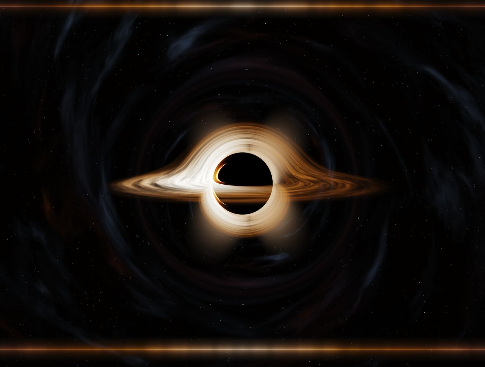
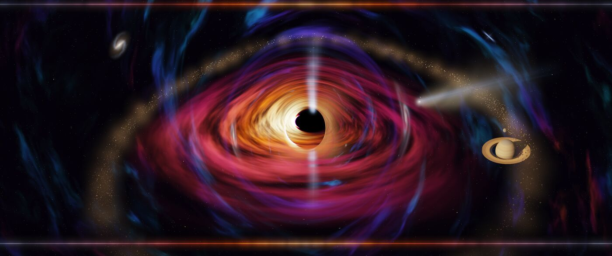
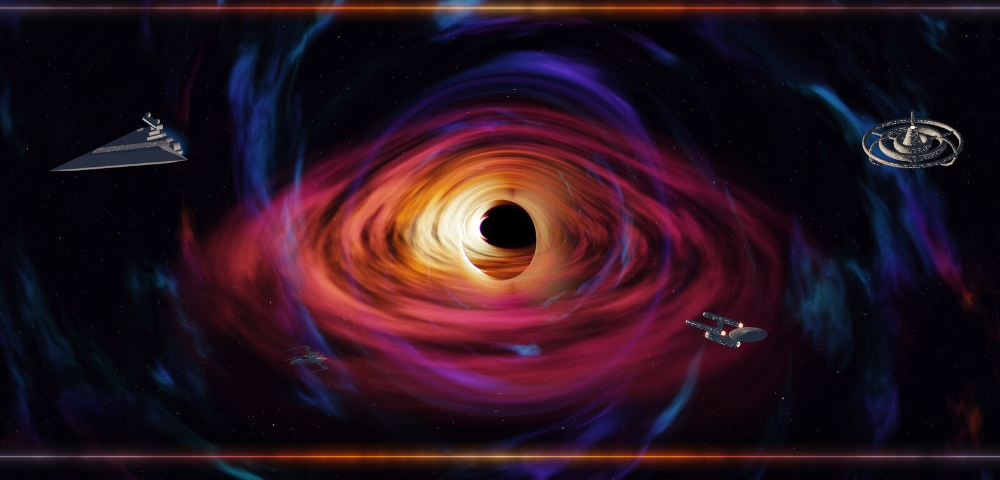

# Black Hole Wallpaper

[Deutsch](README.de.md) · [Website](https://digitaliq.github.io/blackhole-wallpaper/)

A live desktop wallpaper for macOS: a spinning black hole with real gravitational light bending, colored nebulae and a glowing band along the menu bar and the Dock. It also ships as a screen saver.



## What is real and what is not

- **Real:** Every pixel follows a light ray through the spacetime of a spinning black hole (Kerr metric, Hamilton's equations, RK4). That gives the shadow, the photon ring, the bent image of the far side of the disk and the stretched stars near the Einstein ring. The disk starts at the innermost stable circular orbit (ISCO) and turns at Kepler speeds. The side moving toward you is brighter and bluer (Doppler shift and gravitational redshift).
- **Artistic:** the colors. A real disk would look white to orange.

## Features

- **7 presets:** Swirl, Gargantua, M87* as photographed, Top View, Ice Blue, Star System and Sci-Fi Harbor. Duplicate any of them and change every value.
- **Per-monitor presets:** each display can show its own preset and its own position of the hole.
- **Animation levels:** All, Edges Only and Off. With Edges Only the hole stands still and only the bands at the menu bar and the Dock move. On a MacBook Air M4 at 3440 x 1440 that cuts GPU time from about 2 ms to about 0.13 ms per frame.
- **Objects around the hole:** galaxies, distant and nearby stars, planets, moons, asteroids and belts, comets, meteors, a second black hole, a wormhole and a relativistic jet. A galaxy right behind the hole turns into an Einstein ring.
- **Ships and stations from many sci-fi worlds:** Star Trek, Star Wars, Battlestar Galactica, Raumpatrouille Orion, The Expanse, Babylon 5, Firefly, 2001, Interstellar, Mass Effect and others, plus real spacecraft such as Hubble, James Webb and the ISS. Ships jump in and out with warp, hyperspace and similar events.
- **Realistic motion:** bodies follow Kepler orbits, fly-bys run on hyperbolas that the hole deflects, tides stretch bodies close to the hole, and a second hole orbits with the sum of both masses.
- **Quality levels:** Battery Saver, Balanced, High and Ultra, set separately for power adapter and battery. The default is High on the power adapter and Balanced on battery; a level you already chose stays. Each level shows its measured cost.
- **Your own 3D models:** import OBJ, USD, USDZ, PLY, STL, glTF and GLB files.
- **English and German interface.** The app follows the system language.
- **Screen saver** with the same renderer. It shows the preset of the main display.
- **Power aware:** pauses in Low Power Mode, when windows cover the whole desktop, and while the Mac is locked, asleep, in the screen saver or switched to another user. 30 frames per second by default, 60 and 120 are available. When the Mac runs hot, the app halves the frame rate and drops one quality level, and shows a still image when it gets critical (switch: Energy > Throttle when hot). With Reduce Motion on in macOS, the app shows a still image too.
- **Still image as desktop picture:** the app can save a still of the hole as the macOS desktop picture, so the lock screen and Mission Control match.
- **Updates:** the app checks GitHub once a day and installs a new version on request. You can switch this off.





## System requirements

- macOS 15 Sequoia or later
- A Mac with Apple Silicon. The release build is arm64 only.

## Install

### From the DMG

1. Download the newest `BlackHoleWallpaper-<version>.dmg` from the [releases page](https://github.com/DigitalIQ/blackhole-wallpaper/releases/latest).
2. Open it and drag `BlackHoleWallpaper.app` onto the Applications folder.
3. Optional: double-click `Schwarzes Loch.saver` to install the screen saver. It then shows up in System Settings under Screen Saver.

The app lives in the menu bar. Start it a second time, for example from Spotlight, to open its settings window.

### First start of an unsigned app

The app is ad-hoc signed and not notarized by Apple, so macOS blocks it on the first start. Since macOS 15, right-click > Open no longer gets around that. Two ways that work:

- Remove the quarantine flag in Terminal (use `~/Applications/...` if the app lives there):

```bash
xattr -dr com.apple.quarantine /Applications/BlackHoleWallpaper.app
xattr -dr com.apple.quarantine ~/Library/"Screen Savers/Schwarzes Loch.saver"
```

- Or open the app once, then go to System Settings > Privacy & Security, click **Open Anyway** and confirm. Do the same for the screen saver.

### Homebrew

After the first release:

```bash
brew tap digitaliq/tap
brew trust --tap digitaliq/tap
brew install --cask blackhole-wallpaper
```

Homebrew 7 loads casks from other taps only after `brew trust`. Homebrew also quarantines the download, so the first start needs the same step as above: `xattr -dr` or **Open Anyway**. Updates then come with `brew upgrade --cask blackhole-wallpaper`; the app does not replace itself in that case.

### Build from source

You need the Xcode Command Line Tools. Xcode itself is not needed, the Metal shaders are compiled at runtime.

```bash
git clone https://github.com/DigitalIQ/blackhole-wallpaper.git
cd blackhole-wallpaper
./scripts/install.sh
```

This builds the app, copies it to `~/Applications/BlackHoleWallpaper.app`, installs the screen saver to `~/Library/Screen Savers/` and starts the app. `./scripts/make-dmg.sh` builds the same app and screen saver into `build/BlackHoleWallpaper-<version>.dmg` and installs nothing. The version comes from the file `VERSION`.

## Privacy

The app only contacts api.github.com and GitHub's download servers to check for and fetch updates, and you can switch it off (General > Updates > Check for updates automatically). Nothing else goes over the network: no analytics, no crash reporting, no account. The check sends no data about you or your Mac, only a normal request with the app version in the User-Agent. Without the automatic check, the app goes online only when you click **Check Now**. Besides that it opens the Screen Saver pane of System Settings and the GitHub download page, each only when you click the button for it.

It writes only local files:

- `~/Library/Application Support/BlackHoleWallpaper/`: settings (`settings.json`), imported models (`Models/`), still images for the desktop picture (`Stills/`) and, only while an update installs, the downloaded DMG (`Updates/`).
- When you install an update: the new app in place of the old one, and the new screen saver in `~/Library/Screen Savers/` if one is installed there.
- A copy of the main display's look for the screen saver, inside the screen saver's container under `~/Library/Containers/com.apple.ScreenSaver.Engine.legacyScreenSaver/`.
- The macOS desktop picture, only if you turn on the still image option. The app remembers the old picture and can restore it.

## Usage

On the first start a small welcome window opens: pick one of the presets, decide whether the app opens at login (checked by default) and learn where the settings are. It shows only when there was no settings file before. Existing users never see it.

Menu bar icon:

- **Animation**: All, Edges Only or Off.
- **Pause in Low Power Mode**: on by default.
- **Mouse Mode**: a small lens with a mini hole follows the pointer.
- **Preset for All Displays**: quick switch.
- **Settings…** (⌘,): the main window. It also opens when you start the app a second time.
- **Check for Updates…**: checks now and shows the result on the General page. When the daily check found a new version, a line "Version X is available…" appears at the top of the menu. No window opens by itself.
- **Open at Login**
- **Quit**

The settings window has twelve pages: General, Hole, Disk, Colors, Nebula, Stars, Edges, Objects, Motion, Displays, Energy and Quality. Next to each value an undo icon resets only that value. **More > Reset Everything…** restores the factory state.

**Energy** page: frame rate on the adapter and on battery, **Throttle when hot** (on by default) and the still image for the lock screen. **General** page: **Respect Reduce Motion** (on by default). While Reduce Motion is on in macOS, the animation level counts as Off, and a hint under the level says so. The menu shows why the app is paused or throttled.

The **General** page ends with **Updates**: the installed version, the switch **Check for updates automatically** (on by default) and the button **Check Now**. When there is a new version it shows "Version X is available" with the start of the release notes and the buttons **Install**, **Later** and **Skip This Version**.

At the top of the window you first pick the **display**, then the **preset**. If you change a value and another display still uses the same preset, the app first makes a copy for this display, for example "Swirl (Ultrawide)", and changes the copy.

## Developer tools

```bash
.build/release/BlackHoleWallpaper --snapshot shots/wide.png --size 3440x1440 --top 24 --bottom 70
.build/release/BlackHoleWallpaper --snapshot x --size 3440x1440 --bench
.build/release/BlackHoleWallpaper --snapshot x --size 3440x1440 --top 24 --bottom 70 --bench --edges
.build/release/BlackHoleWallpaper --snapshot x --size 3440x1440 --top 24 --bottom 70 --edgecheck
```

`--snapshot` renders a PNG without a window. More flags: `--preset <id>`, `--hole x,y`, `--time`, `--map` (resolution of the ray map), `--nobox` (without the sharp zone), `--debug 1|2|3|4|5|6|7` (3 jet light in front of and behind the disk, 4 mask of the sky objects, 5 jet light only, 6 area searched for bodies behind the hole, 7 where lenses bend and where the main map would lie outside the screen). `--bench` measures GPU time per frame, with `--edges` for the Edges Only level. `--edgecheck` compares the Edges Only strips pixel by pixel with the full image.

Objects in a snapshot:

```bash
.build/release/BlackHoleWallpaper --snapshot shots/ring.png --add galaxy:spiral:az=0,el=0,size=1.5
.build/release/BlackHoleWallpaper --snapshot shots/jet.png --preset m87 --add jet:main:beta=0.9
.build/release/BlackHoleWallpaper --snapshot shots/galaxies.png --catalog galaxy
.build/release/BlackHoleWallpaper --diff a.png b.png
```

- `--add kind:subtype[:key=value,…]`, may be repeated. Keys are `size`, `brightness`, `seed`, `az`, `el`, `drift`, `driftAngle`, `tint`, `tintAmount` and every slider of the catalog, such as `tilt` or `beta`.
- `--objects file.json` takes a scene or a list of objects, `--no-objects` empties the scene.
- `--catalog galaxy|star|jet|all` shows every subtype as a labeled tile.
- `--motion all|edges|off` renders like the animation level: with `edges` and `off` the image stands at 20 s, with `edges` only the bands run up to `--time`.
- `--diff a.png b.png` reports the largest difference per channel and the number of differing pixels, `--tol` sets the allowed difference (default 1).
- For bodies `--add` also knows `mode` (orbit, flyby, edge, fixed), `radius`, `ecc`, `incl`, `node`, `peri`, `phase`, `tempo`, for fixed bodies `x`, `y` and `depth` (front, behind), for edge objects `edge`, `dir`, `side`, `offset`, `edgeSpeed`, `edgeGap`, `wobble`, for fly-bys `passMin`, `passMax`, `interval`, `fly`, for moons `attach`, and `near=1` turns a star into a nearby star.
- `--catalog planet|moon|nearstar|asteroid|comet|meteor|belt` shows these kinds.
- `--catalog blackHole|wormhole` shows second holes and the wormhole. For a second hole `size` is the mass relative to the main hole, also when fixed in the image (`mode=fixed`, with `depth=behind` behind the plane of the main hole). Sliders such as `spin`, `inclination`, `roll`, `jet`.
- `--catalog ship|station` shows ships and stations, `--only enterprise,falcon` or `--only "Star Trek"` only these tiles.
- `--event warp --phase 0.5` freezes an event (with `--arrival` as an arrival), `--phases 0.2,0.45,0.7` puts several phases side by side. `--vertical` stacks `--series` and `--phases` vertically.
- For ships `--add` also knows `events` (0 or 1), `eventKinds` (for example `warp+cloak`), `eventInterval`, and for your own models `model` (file name in the Models folder). `BH_MODELS=/path` uses another model folder.
- `--export-ship enterprise file.obj` writes a built-in ship as OBJ, USDA, USDC or PLY. `--import-check file` loads a file like the app does and reports triangles, parts, materials and images.
- `--series 20,21,22 --crop x,y,w,h` puts several points in time side by side in one labeled image, optionally cropped. With `--motion edges` only the edge keeps running.
- `--drop planet,comet` removes kinds from the scene, for example to measure part of a preset.
- `--bench-ab` measures the same view without and with objects, alternating frame by frame in the same run, and reports the median of 480 frames, so warm-up and clock changes hit both equally. `--bench-geo` does the same for recomputing the rays. `--jet-stats` compares the brightness of jet and counter-jet.
- `--bench-passes` also alternates, but per pass (Metal timestamps at the boundaries of each pass), and shows which pass costs how much more with objects. `--pace 30` paces `--bench-ab` and `--bench-passes` at 30 frames per second like the running app, so the GPU clocks down between frames as it does live. The values scatter a lot that way, live measurements compare better.
- Quality: `--quality 0...3`, `--qa jet=3`, `--bench-q 1`. Without `--quality` a snapshot renders at Balanced. `./scripts/check-referenz.sh <folder>` compares the five presets without objects with reference pictures made at Balanced and passes `--quality 1` explicitly, because the app itself now defaults to High on the power adapter.

```bash
.build/release/BlackHoleWallpaper --settings-shot shots/settings.png --tab 0
```

This draws the settings window into a PNG, pages 0 to 11. It reads `settings.json` but does not write it. `--all-screens` shows the "All Displays" selection, `--locked-demo` adds an invented second display with another preset, which is the locked state. `--objects-demo` puts a fixed scene into the preset for the image (page 7), `--ships-demo` one with ships and a station, `--exotics-demo` one with a second hole and the Sci-Fi Harbor, `--height` makes the window taller.

```bash
.build/release/BlackHoleWallpaper --selftest
```

Runs the per-display copy rules with two invented displays, without a screen and without touching `settings.json`. It also checks the objects: old files without a scene, unknown kinds, missing keys, broken items, saving and loading, the per-display copy. With `--settings-file copy.json` it also checks that a real settings file loads without loss. Exit code 0 means passed.

Fix the frame rate for testing: `defaults write io.github.digitaliq.blackholewallpaper fpsOverride 30`

For measuring: `BH_DEBUG=1 .build/release/BlackHoleWallpaper` writes frames per second and GPU time per frame to the log every five seconds, for Edges Only per strip. With `BH_SETTINGS=/path/copy.json` the app loads and saves another settings file and leaves the screen saver alone, so you can measure a preset live without touching your own settings. With `BH_PROFILE=1` as well, the log also shows GPU time per pass. The log also names every change of the run state (paused, throttled, still image) and counts the frames started every five seconds, which is zero while paused.

Tests of the first-start window and the pause: `BH_FORCE_WELCOME=1` shows the welcome window even with a settings file, and `--settings-shot x.png --welcome` takes a picture of it (with `--lang en` or `de`). On a run with `BH_SETTINGS`, the distributed notification `io.github.digitaliq.blackholewallpaper.test` fakes states: its object is `lock`, `unlock`, `heat:nominal|fair|serious|critical`, `heat:off`, `motion:on|off|auto`. `BH_FAKE_REDUCE_MOTION=1` makes the settings pictures show the Reduce Motion hint. A run on a settings copy never registers the login item.

### Updates

The updater asks `https://api.github.com/repos/DigitalIQ/blackhole-wallpaper/releases/latest`, ignores drafts and prereleases and compares `tag_name` with `CFBundleShortVersionString`. It installs only `BlackHoleWallpaper-<version>.dmg` together with `BlackHoleWallpaper-<version>.dmg.sha256` from the same release. Steps: download into `Application Support/BlackHoleWallpaper/Updates`, check the SHA-256, mount read-only, check bundle ID, version and signature, copy app and screen saver next to the old ones, swap them by renaming, remove the quarantine flag, and start the new app once the old one has quit. On any error the old version stays. A copy installed with Homebrew does not replace itself, and a copy in a folder without write access opens the download page.

```bash
BH_UPDATE_FEED=/path/feed.json BH_SETTINGS=/path/copy.json BlackHoleWallpaper.app/Contents/MacOS/BlackHoleWallpaper --update-check
./scripts/e2e-update.sh 1.0.1
```

`--update-check` prints what the updater would do and changes nothing. `--update-install` does it without a window. `BH_UPDATE_FEED` takes a file path or an http(s) or file URL in the shape of the GitHub answer; with it, files may come from anywhere, without it only over https from github.com. `BH_SAVER_DIR` replaces `~/Library/Screen Savers`; with `BH_SETTINGS` and without `BH_SAVER_DIR` the installed screen saver stays untouched. `scripts/e2e-update.sh` builds the current version into `.tmp/e2e`, builds a DMG with a higher version (`BH_VERSION`, the file `VERSION` stays), updates the copy through a local feed, checks that it relaunches with the new version and quits it.

Translating the interface is described in `docs/uebersetzen.md` (German). Design notes and measurements for objects and quality levels are in `docs/objekte-plan.md` (German).

## Source layout

- `Shaders.swift`: Metal code. `geoFrag` traces the rays once per view, `geoFragJet` also collects the light of the jet, and both store the result in textures: once at half resolution for the whole screen and once at full resolution for a square around the hole, where the sharp edges are. `bakeDisk` bakes the gas pattern of the disk. `dispFrag` runs every frame and only animates. `edgeFrag` draws only the strips at the bands for Edges Only.
- `Renderer.swift`: Metal pipelines and textures per display.
- `Wallpaper.swift`: one window per display at desktop level, plus the two strip views for Edges Only.
- `AppDelegate.swift`: menu, power saving, display changes.
- `Settings.swift`, `Store.swift`: presets, palettes, per-display settings and the JSON file.
- `SettingsView.swift`: the settings window in SwiftUI and the short name display on a screen.
- `Objects.swift`: the data model of the scene, lenient when loading.
- `ObjectCatalog.swift`: all subtypes with their sliders, defaults and randomizing.
- `ObjectSystem.swift`: per frame clocks, directions in the sky, pulsar flashes and the values for the shaders.
- `ObjectShaders.swift`: Metal code for sky objects, jet light and baking the galaxies. A mask in 8 x 8 pixel cells says where each object can be visible; only there is work done.
- `Orbits.swift`: camera frame with the same pixel to direction mapping as the rays, Kepler orbits, fly-bys, edge paths, point lens.
- `BodyRenderer.swift`: per frame position, light and tiles of the bodies, particles, comet tails, meteors, halo and diffraction spikes of stars. A tile cache redraws a body only when something visible changed.
- `BodyShaders.swift`: Metal code of the bodies. Planet surfaces are baked once, a compute kernel writes each tile into the atlas.
- `ObjectsTab.swift`: the Objects page.
- `ShipCatalog.swift`: the part lists of all ships and stations and the events.
- `MeshBuilder.swift`: the parts as triangle meshes, import and export through ModelIO.
- `ShipSystem.swift`: event schedule, position of the ships in space.
- `Lenses.swift`: second holes, wormholes and gates as lenses: position per frame, data for the shaders, the small ray maps of the holes (shared between displays).
- `LensShaders.swift`: Metal code of the lenses.
- `ShipShaders.swift`: Metal code of the ships: materials with metalness and roughness, reflection of sky and disk, hull plates, windows, glow.
- `Profiler.swift`: GPU time per pass from Metal timestamps, for `--bench-passes` and `BH_PROFILE=1`.
- `ModelStore.swift`: the Models folder and the copy for the screen saver.
- `ModelImage.swift`: images of model files through ImageIO, at most 1024 pixels.
- `GLTFLoader.swift`: own loader for glTF 2.0 and GLB (ModelIO cannot read glTF).
- `Strings.swift`, `Localization.swift`, `UIText.swift`: interface texts in German and English.
- `Quality.swift`: the quality levels and their measured cost.
- `Updater.swift`: the update check, download, checksum, swap and relaunch, plus `--update-check` and `--update-install`.
- `SelfTestUpdate.swift`: self-test of the updater with a fixture of the GitHub answer.
- `SelfTest.swift`: `--selftest`.
- `Stills.swift`: still image as desktop picture and the change over the day.
- `Saver/BlackHoleSaverView.swift`: the screen saver. `scripts/build-saver.sh` builds it from the same renderer files.

## License

MIT, see [LICENSE](LICENSE). Copyright 2026 DigitalIQ.

Star Trek, Star Wars, Battlestar Galactica, Babylon 5, Firefly, The Expanse, Mass Effect, Stargate and the other named works belong to their owners. This project is not affiliated with them. The ships are simple shapes built in code, not copied models.
